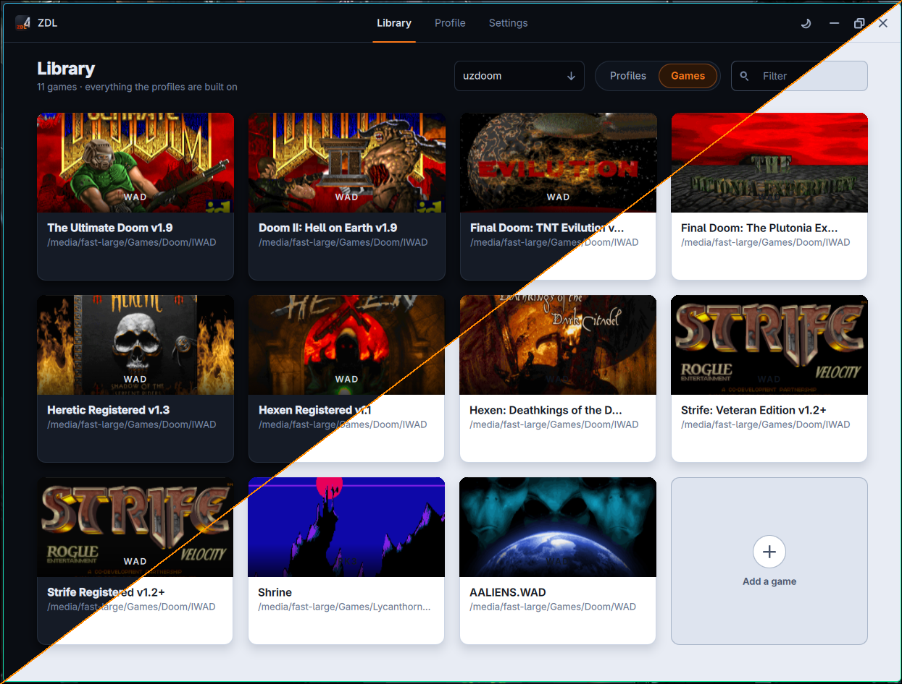

# ZDL4

[](https://github.com/spacebub/qzdl/actions/workflows/ci.yml)
[](https://github.com/spacebub/qzdl/actions/workflows/release.yml)
[](https://github.com/spacebub/qzdl/releases/latest)
[](https://github.com/microsoft/winget-pkgs/tree/master/manifests/s/spacebub/qzdl)

A launcher for Doom engine source ports. Pick a port, pick a game, add whatever
you want on top of it, and launch.



## Install

Grab the build for your system from the
[releases page](https://github.com/spacebub/qzdl/releases), or on Windows:

```
winget install spacebub.qzdl
```

ZDL4 is only the launcher. The source port and the game data (IWADs/IPK3s) are
yours to get separately.

## Quick start

1. Open **Engines** and add the source ports you have, or fetch one under
   **Get more**. Games are added on the library's games shelf.
2. On the library, press **New profile**, or click a game to play it as it is.
3. Pick a port and a game, add PWADs or patches under **Add-ons**, and press
   **Launch**.

Add-ons load in the order listed, and each can be switched off without being
removed. A folder works as an add-on too, which is how an unpacked mod is
loaded. In the file picker, a folder opens from its row and is picked from its
right edge.

## Engines

**Installed** holds the ports this config knows about. Ports already on the
machine are found and listed too. A port's card renames it, points it at
another file, opens it in a file manager or removes it.

**Get more** lists the ports ZDL4 can fetch, and these are the ones it knows
best. **Install** gets the build for this system, unpacks it and adds it to the
installed ones. **Update** takes its place once a newer release is out, and
keeps every profile pointed at the port. Removing a fetched port deletes what
was unpacked. A DOS port is marked as one and launches inside DOSBox.

Releases are looked up on GitHub when the page opens. Nothing else is sent
anywhere, and nothing is downloaded until asked for. A port without a build for
this system says so and links to its own page.

Every download is checked against the size and SHA-256 checksum its release
lists, or a checksum built into ZDL4 for the few fetched elsewhere, before it
is unpacked. A mismatch is thrown away. That catches a corrupt or swapped file,
not a compromised project. Downloads are kept and reused on a reinstall, checked
again each time. Settings shows how much room they take.

## Profiles

A profile is a saved launch: port, game, add-ons, map, skill, multiplayer and
the rest. It can be a game, a single mod, a multiplayer setup or anything else
worth coming back to. Switch between them from the heading at the top of the
page.

A profile's card shows a title screen from what it loads: the last add-on that
carries one, else the game's.

## Per profile port settings

A port's own settings, controls, video and sound, normally live in one file
shared by every launch. Turn on **A config file per profile** in Settings and
each profile gets its own. A profile can opt back out with **Use the port's own
settings** on its page.

## Saves directory

Where the port allows it, a profile keeps its saves in a folder of its own
under the data directory. See [Where things are kept](#where-things-are-kept).

## Custom launch commands

The profile page builds the command line. For a launch it cannot describe, turn
on **Override** under Command line and write your own. These words stand for
what the page already knows, so no path needs typing or upkeep:

| Word            | Stands for                                             |
|-----------------|--------------------------------------------------------|
| `{source_port}` | the source port this profile is set to                 |
| `{game}`        | the game this profile is set to                        |
| `{addon_n}`     | an add-on from the list, `{addon_1}` up to `{addon_n}` |
| `{profile}`     | the profile's own folder, where those below live       |
| `{cfgdir}`      | the port config written for this profile               |
| `{extracfg}`    | a vanilla port's second config, `-extra` on the name   |
| `{savedir}`     | the profile's saves folder `{profile}/saves`           |

A word the profile cannot fill (`{addon_3}` on a profile with two) is flagged
under the field, and the profile does not launch until it is fixed. Everything
else is passed on as typed, so the launch can be wrapped in anything the system
has: `{source_port} -iwad {game}`. The command starts as the one ZDL4 would
have run, written in these words, so there is a line to edit rather than a
blank one.

## DOS ports

Mark a port as a DOS program when adding or editing it and it launches inside
DOSBox. The DOS ports ZDL4 fetches are marked already. Point Settings at a
DOSBox, or leave it empty to use whichever one the machine has.

The port runs from its own folder, as under DOS, so a batch file that starts
one works as a port too. A game the port has to find for itself is handed over
through `DOOMWADDIR`, copied under the name it expects when it goes by another.
A DOS profile gives DOSBox the whole screen unless **Full screen** is off on its
page, and closes DOSBox with the port unless **Auto close** is off.

## Where things are kept

|                             | Linux                              | Windows                       |
|-----------------------------|------------------------------------|-------------------------------|
| Settings (`zdl.json`)       | `~/.config/qzdl`                   | `%APPDATA%\qZDL`              |
| Per profile port configs    | `~/.local/share/qzdl/profiles`     | `%APPDATA%\qZDL\profiles`     |
| Fetched source ports        | `~/.local/share/qzdl/source_ports` | `%APPDATA%\qZDL\source_ports` |
| What they were fetched from | `~/.local/share/qzdl/downloads`    | `%APPDATA%\qZDL\downloads`    |

A `zdl.json` next to the executable is used when there is no per user config,
which keeps a portable setup portable. A config from an older ZDL is found in
its old location and converted on first run. A single launch can be exported to
and imported from a `.zdl` file.

## Building

See [COMPILE.md](COMPILE.md).

## License

Copyright (c) 2023-2026 spacebub  
Copyright (c) 2018-2019 Lcferrum  
Copyright (c) 2004-2012 ZDL Software Foundation  

GNU General Public License, version 3. See [LICENSE](LICENSE).

Uses the SDL, Blend2D, miniz, stb, md5, sha256 and yyjson libraries. See [AUTHORS](AUTHORS.md).
